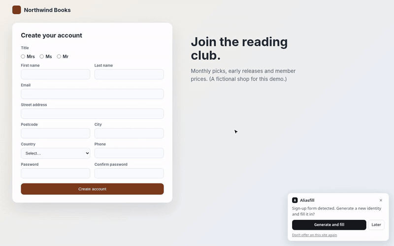
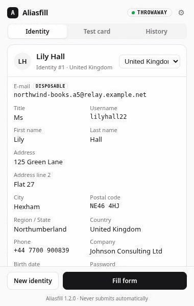

# Aliasfill

[](https://github.com/PierreEbele/Aliasfill/actions/workflows/ci.yml)
[](https://addons.mozilla.org/firefox/addon/aliasfill/)
[](https://addons.mozilla.org/firefox/addon/aliasfill/)

**[Get it for Firefox](https://addons.mozilla.org/firefox/addon/aliasfill/)** · Chrome/Chromium: download the `-chrome.zip` from the [latest release](https://github.com/PierreEbele/Aliasfill/releases/latest) and load it unpacked (see [Setup](#setup)).

Browser extension for Firefox and Chrome/Chromium that fills sign-up forms with a fake identity and a disposable e-mail address for the site.



<details><summary>The popup: identity, country, history per site</summary>



</details>

Demo video (32 s): [docs/media/aliasfill-demo.mp4](docs/media/aliasfill-demo.mp4). The shop in the demo is fictional; screenshots for the stores are in [docs/media](docs/media).

`extension/` holds the extension, for Firefox and Chrome/Chromium (Edge, Brave, Vivaldi…) from one codebase. It fills sign-up forms with a fake identity (name, address, phone, birth date, password, test card) and a **disposable e-mail address for the site**. It started inside [Throwaway Mail](https://github.com/PierreEbele/throwaway-mail), a self-hosted disposable address server, and now lives here on its own.

It works **without a Throwaway Mail server**: the address can come from your own catch-all domain, plus-addressing on your mailbox, or an alias service you already use. Only a Throwaway Mail server reads the mail it receives, so verification-code autofill is available with Throwaway Mail only; with any other provider you read the code in your mailbox.

## Address providers

Pick one in the extension settings (⚙ in the popup header) under _Where do addresses come from?_. Until one is set up, identities use `@example.com` addresses and nothing leaves the browser (badge `LOCAL`).

| Provider                      | Creates the address with                                                               | Settings                                                                                   | Self-hosted URL | Codes |
| ----------------------------- | -------------------------------------------------------------------------------------- | ------------------------------------------------------------------------------------------ | --------------- | ----- |
| **No service** (default)      | nothing: built in the browser, `netflix.k3x9q2@your-domain` or `you+netflix@gmail.com` | catch-all domain + pattern, or your own address                                            | —               | no    |
| **Throwaway Mail**            | `POST /v1/addresses` (Bearer API key)                                                  | server, API key, domain (fixed, or random/rotating among a chosen list), expiry, max mails | yes             | yes   |
| **SimpleLogin**               | `POST /api/alias/random/new?hostname=<site>` (`Authentication: <key>`)                 | API key                                                                                    | yes             | no    |
| **addy.io**                   | `POST /api/v1/aliases` (Bearer token)                                                  | API token, alias domain                                                                    | yes             | no    |
| **Firefox Relay**             | `POST /api/v1/relayaddresses/` (`Authorization: Token <key>`)                          | API key                                                                                    | no              | no    |
| **Fastmail Masked Email**     | JMAP `MaskedEmail/set` on `api.fastmail.com`                                           | API token with the _Masked Email_ scope                                                    | no              | no    |
| **Forward Email**             | `POST /v1/domains/<domain>/aliases` (Basic auth, token as user name)                   | API token, domain                                                                          | yes             | no    |
| **DuckDuckGo** _experimental_ | `POST quack.duckduckgo.com/api/email/addresses` (Bearer token)                         | token                                                                                      | no              | no    |

- **No service.** _Catch-all domain_: a domain whose mail server accepts any local part (Cloudflare Email Routing catch-all, Fastmail/Proton/Migadu catch-all…). The pattern takes `{site}` (the site's name, `netflix` for `www.netflix.com`, `bbc` for `shop.bbc.co.uk`) and `{random}` (6 characters); default `{site}.{random}`. _Plus-addressing_: `you+netflix@gmail.com`, supported by Gmail, Outlook, Proton, Fastmail and most providers. Nothing is sent anywhere; _Preview an address_ shows one.
- **DuckDuckGo** has no public API. The extension calls the endpoint DuckDuckGo's own extension uses (also used by Bitwarden's generator); it can break without notice, and there is no read-only endpoint, so _Test connection_ only checks that a token is present. The token is the one DuckDuckGo's extension keeps after you sign in to Email Protection.
- Every provider gets the site's host name (as `hostname`, `generated_for`, `forDomain`, label or description depending on the API) so you can find the alias later; Throwaway Mail also gets the fake name as the label.
- _Test connection_ calls a read-only endpoint (`/api/user_info`, `/api/v1/account-details`, `/api/v1/profiles/`, the JMAP session, `/v1/account`, `/v1/auth/me`). _Save_ stores the settings in the extension's local storage and makes the provider active.

The adapters live in `extension/providers/*.js`; each registers `{ id, name, codes, fields, configured, createAlias, testConnection, waitForCode? }` with `extension/providers/index.js`, which also stores settings (`aliasProvider`, `providerSettings`; Throwaway Mail keeps its `tm*` keys) and builds the address object. Settings saved by the extension when it was still part of Throwaway Mail (a server and API key) select that provider.

## What it does

- **Fill form.** A fresh identity and an address for the open site from the active provider, filled in one click. One address per site and identity; filling again on the same host reuses it. **New identity for every new site** by default.
- **Automatic prompt.** On a page that looks like a sign-up form (new-password field, two password fields, or an e-mail field with sign-up wording), a small card offers _Generate and fill_. _Don’t offer on this site again_ remembers the host.
- **Passwords that fit the site.** The 20-character password is typed as is when the form accepts it. If a field's `maxlength`, `minlength` or `pattern` refuses it, the filler types the closest accepted variant (cut to length keeping an upper case letter, a lower case letter, a digit and a symbol, or letters and digits only) and the identity keeps that password, instead of skipping the field.
- **Identities that fit the country.** Australia, Austria, Belgium, Canada, France, Germany, Ireland, Italy, the Netherlands, Portugal, Spain, Switzerland, the United Kingdom or the United States (or random), with common names of that country. See [Fake identities](#fake-identities).
- **History per site.** The _History_ tab lists the identity used on each site (name, address, password, date): search, _Copy_, _Reuse_ (the next fill on that site keeps it) and _Delete_ one entry or _Clear history_. Kept in `storage.local` only, for 90 days by default (_Keep the history of identities per site_ in the settings: 7 days to 1 year, until deleted by hand, or no history at all).
- **Right-click menu.** _Insert a disposable address here_ on any editable field reuses this site's address (or creates one) and inserts it.
- **Bitwarden mode.** Leaves e-mail and password to Bitwarden (its generator, its vault) and fills the rest.
- Nothing is ever submitted.

### With Throwaway Mail only (code autofill)

- **Verification code.** The popup shows a _Verification code_ panel: _Wait for code_ long-polls `GET /v1/addresses/:id/code` (up to 2 × 55 s, the popup must stay open), then _Copy_ or _Paste_. Mails with only a confirmation link show the link.
- **Code pasted automatically.** After a fill, the page waits for the mail (through the background script, 20 s long polls, up to 15 min) and pastes the code as soon as it arrives, even after the site moves to its "enter the code" page.
- **One-time-code autofill.** On a one-time-code field (`autocomplete="one-time-code"`, a name like code/otp/verification/2fa/pin, a 4–8 character numeric field, or 4–8 one-digit boxes), the extension looks up this site's address and its latest code from the last 15 min, then shows a _Fill code 123456_ chip (or fills it directly with _Fill one-time-code fields directly_). Detection is in `extension/otp.js`.
- **Toolbar badge.** The active site's address unread count, or a red `!` if a leak was detected.
- **Address format and defaults** follow your account (_Account → New addresses_); the extension options _New addresses expire after_ / _stop after_ override them when set.

With any other provider these controls are hidden: the popup shows no code panel, the settings explain why, and the content script never polls.

## Fake identities

Each identity has a title, a first and last name, a username derived from the name, a company, an address (street, second line, postcode, town, region or state, country), a phone number, a birth date (18 to 75 years old) and a 20-character password.

- **Title and first name agree.** Given names are listed by gender in each country sheet; the title (_Mme_, _Herr_, _Mr_…) is one of that gender's, and a locked first name or title keeps it. A title or gender `<select>` or radio group (_Mme ○ M. ○_, _Female ○ Male ○_, even with the input hidden behind a styled label) is matched in the local language or in English (_Mrs_, _Ms_, _Female_…); _Undo_ restores the previous choice.
- **Real towns, never anyone's address.** Towns, postcodes and regions are real (so sites that check the postcode against the town accept them): full postcodes for the United Kingdom (postcodes.io, ONS data) and, for the Netherlands and Portugal, real postcode, street and house number together (PDOK BAG data, geoapi.pt CTT data), as sites there check them against each other. Irish Eircodes use the town's real routing key and a random second half. Elsewhere the street is a common one for the country and the house number is random. The name is drawn on its own, so no address is tied to the people who live there.
- **Phone numbers reserved for fiction where they exist.** Where the country's regulator keeps a range out of service for films and fiction, the phone comes from it (source noted in the sheet). Elsewhere it is a random mobile number in the country's format: it is not reserved and may belong to a real subscriber (the popup says so on the phone).

| Country                                                            | Phone range                                                                                            | Source                                                                                                                                      |
| ------------------------------------------------------------------ | ------------------------------------------------------------------------------------------------------ | ------------------------------------------------------------------------------------------------------------------------------------------- |
| France                                                             | 06 39 98 00 00 – 06 39 98 99 99                                                                        | ARCEP decision 2025-2215, §2.5.12                                                                                                           |
| United Kingdom                                                     | 07700 900000 – 07700 900999                                                                            | [Ofcom, numbers for drama](https://www.ofcom.org.uk/phones-and-broadband/phone-numbers/numbers-for-drama)                                   |
| United States                                                      | 555-0100 – 555-0199 (any area code)                                                                    | [NANPA, 555 line numbers](https://nanpa.com/numbering/555-line-numbers)                                                                     |
| Canada                                                             | 555-0100 – 555-0199 (any area code)                                                                    | [NANPA, 555 line numbers](https://nanpa.com/numbering/555-line-numbers)                                                                     |
| Germany                                                            | 0171 39200 00–99, 0176 040690 00–99                                                                    | [Bundesnetzagentur, Drama Numbers](https://www.bundesnetzagentur.de/DE/Fachthemen/Telekommunikation/Nummerierung/DramaNumbers/artikel.html) |
| Ireland                                                            | 089 011 0000 – 089 011 0999                                                                            | ComReg, Numbering Conditions of Use (June 2023), [numbering](https://www.comreg.ie/industry/licensing/numbering)                            |
| Australia                                                          | (02/03/07/08) 5550 xxxx                                                                                | [ACMA, numbers for creative works](https://www.acma.gov.au/phone-numbers-use-tv-shows-films-and-creative-works)                             |
| Austria, Belgium, Italy, Netherlands, Portugal, Spain, Switzerland | random mobile number in the local format (06xx…, 04xx…, 3xx…, 06…, 9xx…, 6xx…, 07x…), **not reserved** | no reserved range found at the RTR, BIPT, AGCOM, ACM, ANACOM, CNMC or OFCOM/BAKOM (checked 2026-11-07)                                      |

The filler recognises the new fields by `autocomplete` (`honorific-prefix`, `organization`, `address-line2`, `address-level1`) or by their labels in English, French, German, Spanish, Italian and Dutch, and picks the matching option of country, region/state and title selects. Each field can be unticked or locked in _Fields to fill_.

### Adding a country

Each country is one file, `extension/data/<code>.js`, that registers a sheet with `AliasfillCountries.register({...})`: names (`female`, `male`, `last`), titles, company suffixes, streets, second address lines, places (`city`, `region`, `regionCode`, `postal`…, and optionally `addresses`: `{ postal, street, numbers }` that go together), `postalPattern`, `postalCode(place, rand)`, `address(number, street)` and `phone` (`{ source, generate(rand, place) }`, or `null`). Add its path to `files` in `extension/data/index.js` and load it with the others in `manifest.json` (`background.scripts`), `service-worker.js` and `popup.html`; `tests/countries.test.ts` checks that every list agrees, and needs the country's expected formats. `generate()` does not change.

## Permissions

| Permission                                    | Why                                                                                                                                                                                                                                                                                                                                                                                                                  |
| --------------------------------------------- | -------------------------------------------------------------------------------------------------------------------------------------------------------------------------------------------------------------------------------------------------------------------------------------------------------------------------------------------------------------------------------------------------------------------- |
| `storage`                                     | identity, history of identities per site, settings and the provider's key, in the browser profile only                                                                                                                                                                                                                                                                                                               |
| `activeTab`, `scripting`                      | fill the open tab when you click _Fill form_                                                                                                                                                                                                                                                                                                                                                                         |
| `menus` (`contextMenus` on Chrome)            | the right-click _Insert a disposable address here_                                                                                                                                                                                                                                                                                                                                                                   |
| `alarms`                                      | delete expired identities, refresh the badge                                                                                                                                                                                                                                                                                                                                                                         |
| content script on `http://*/*`, `https://*/*` | detect sign-up forms and (Throwaway Mail) code fields                                                                                                                                                                                                                                                                                                                                                                |
| host access `http://*/*`, `https://*/*`       | fill a tab from the sign-up card (without a popup click, `activeTab` does not apply) and reach the provider's API without CORS. Chrome grants it at install. Firefox treats it as optional: on _Test connection_ / _Save_ the extension asks only for **the chosen provider's API origin** (e.g. `https://app.simplelogin.io/*`; _No service_ asks for none), and the _Allow on all sites_ banner asks for the rest. |

The provider's key is only sent to that provider's API. Extensions with host access are not subject to CORS, so no server needs a change.

## Setup

1. Build both packages: `pnpm install`, then `pnpm pack` (or `sh scripts/pack-extension.sh`) →
   - `dist/aliasfill-<version>.xpi` (Firefox),
   - `dist/aliasfill-<version>-chrome.zip` (Chrome/Chromium).
2. Install:
   - **Firefox:** install it from [addons.mozilla.org](https://addons.mozilla.org/firefox/addon/aliasfill/) (signed, updated automatically). To try a local build: `about:debugging#/runtime/this-firefox` → _Load Temporary Add-on_ → pick `extension/manifest.json` (removed at restart).
   - **Chrome/Chromium:** unzip the `-chrome.zip` into a folder you keep, open `chrome://extensions`, enable _Developer mode_, _Load unpacked_ → that folder. Chrome 121 or later.
3. Settings (⚙ in the popup): pick the provider, fill its fields, _Test connection_, _Save_. For Throwaway Mail: _API keys → Create_ in the app (name it after the browser), server `https://mail.example.com`, paste the key, pick the preferred domain. The domain is a preference: when a site is known to reject it (see _Sites that reject a domain_ in the Throwaway Mail user guide), the server picks another one.

## Development

```bash
pnpm install
pnpm test        # adapters against fake HTTP, background script, generator, one-time-code detection, Chrome manifest
pnpm test:e2e    # the Chrome build in a real Chromium (pnpm exec playwright install chromium once)
pnpm lint        # types + formatting
pnpm lint:firefox  # Mozilla's add-on linter (what addons.mozilla.org runs), warnings fail
pnpm format
pnpm pack        # dist/aliasfill-<version>.xpi and dist/aliasfill-<version>-chrome.zip
```

Tests run the extension's own files in a Node `vm` with a fake `browser` and a fake `fetch` (`tests/fake-throwaway.ts` stands in for a Throwaway Mail server): no network, no browser. `pnpm test:e2e` loads the Chrome build unpacked in Chromium (Playwright) and fills local test pages: title radios, region and country selects, Undo, the history in the popup, and the verification code pasted from the fake Throwaway Mail server. Store listing drafts can be kept locally in `extension/store/` (git-ignored, left out of the packages).

## Releasing

1. Bump `version` in `extension/manifest.json` and `package.json`, commit.
2. Tag and push: `git tag -a v1.1.0 -m "Aliasfill 1.1.0" && git push origin v1.1.0`.

The **Release** workflow then runs the tests and Mozilla's linter, checks the tag matches the manifest, builds both packages, creates the GitHub release with them, and submits the version to addons.mozilla.org (listed channel). Mozilla reviews it, then publishes it and Firefox updates installed copies on its own.

The AMO step needs two repository secrets, `AMO_JWT_ISSUER` and `AMO_JWT_SECRET`, from [addons.mozilla.org → Manage API Keys](https://addons.mozilla.org/developers/addon/api/key/). Without them it is skipped and the GitHub release is still made.

## Privacy

See [PRIVACY.md](PRIVACY.md): no analytics, nothing sent unless you set up an alias provider, and then only to that provider.

## License

MIT, see [LICENSE](LICENSE).

## One codebase, two builds

`extension/manifest.json` is the Firefox manifest and the source of truth; `scripts/chrome-manifest.mjs` derives the Chrome one at pack time. The differences:

|                                                         | Firefox                           | Chrome (MV3)                                                                            |
| ------------------------------------------------------- | --------------------------------- | --------------------------------------------------------------------------------------- |
| Background                                              | `background.scripts` (event page) | `background.service_worker` = `service-worker.js`, which `importScripts` the same files |
| Context menu permission                                 | `menus`                           | `contextMenus`                                                                          |
| `browser_specific_settings` (gecko id, data collection) | yes                               | removed                                                                                 |
| Icons                                                   | `icons/aliasfill.svg`             | `icons/aliasfill-{16,32,48,128}.png` (Chrome does not render SVG)                       |

The code only uses Firefox's promise-based `browser.*` API. `extension/compat.js`, loaded first everywhere (background, content script, popup, options), is a no-op on Firefox; on Chrome it exposes `browser` as a view of `chrome` with `browser.menus` → `chrome.contextMenus` and `runtime.onMessage` listeners that may answer by returning a Promise (bridged to `sendResponse`). When you edit the extension, keep using `browser.*` and test both builds. A new background script must be listed in both `manifest.json` (`background.scripts`) and `service-worker.js`, and a new provider file in `popup.html` and `options.html` too (a unit test checks it).
